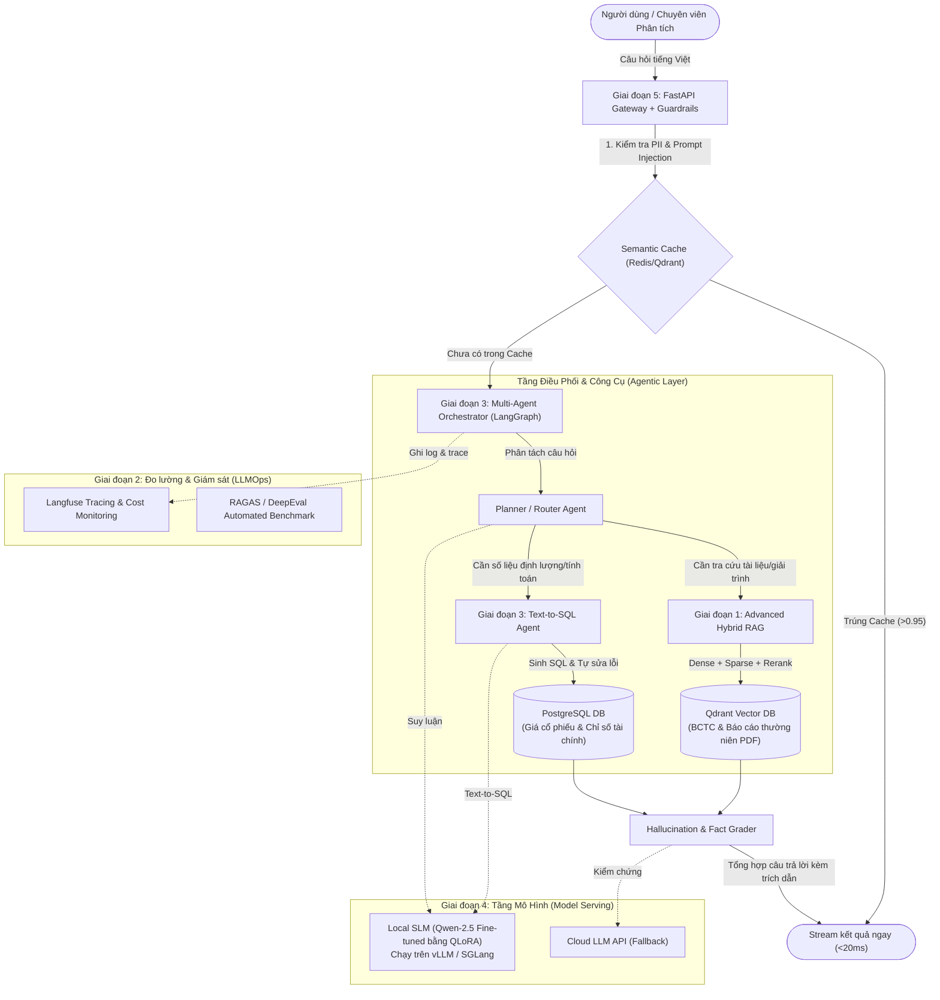

# 00. Tổng Quan Dự Án VnFinCopilot & Lộ Trình Học Từ Con Số 0

> **Mục tiêu tài liệu:** Giúp bạn hình dung bức tranh toàn cảnh về nghề **AI Engineer**, hiểu rõ chúng ta sắp xây dựng hệ thống gì, tại sao từng thành phần lại tồn tại, và thứ tự học tập từ con số 0 để sẵn sàng cho môi trường thực chiến đỉnh cao như **VinAI**.

---

## 1. AI Engineer là ai? (Khác gì với Data Scientist và ML Researcher?)

Khi mới bắt đầu, rất nhiều người nhầm lẫn giữa 3 vị trí này:

| Tiêu chí | ML Researcher (Nghiên cứu) | Data Scientist (Khoa học dữ liệu) | **AI Engineer (Kỹ sư AI thực chiến)** |
| :--- | :--- | :--- | :--- |
| **Trọng tâm** | Phát minh kiến trúc mô hình mới, thuật toán tối ưu mới, viết bài báo khoa học (Paper). | Phân tích dữ liệu, tìm insight kinh doanh, huấn luyện mô hình dự báo (Tabular ML: XGBoost, LightGBM). | **Đưa các mô hình AI/LLM lớn vào sản phẩm thực tế** sao cho trả lời chính xác, chạy nhanh, chịu tải cao, chi phí thấp và an toàn. |
| **Công cụ chính** | PyTorch thuần, CUDA, Toán tối ưu. | Pandas, Scikit-learn, SQL, PowerBI, Jupyter Notebook. | **Python (FastAPI, AsyncIO, Pydantic), Vector DB (Qdrant), RAG, Agent (LangGraph), Fine-tuning (LoRA/Unsloth), Serving (vLLM), Docker, LLMOps (Langfuse).** |
| **Bài toán điển hình** | Làm sao để cơ chế Attention chạy nhanh hơn $O(N^2)$? | Dự đoán khách hàng nào sắp hủy dịch vụ vào tháng tới? | Làm sao để hệ thống đọc 10.000 trang Báo cáo tài chính + Database chứng khoán và trả lời câu hỏi phức tạp trong < 2 giây mà không bịa đặt số liệu? |

👉 **Kỳ vọng của các chương trình như VinAI:** Họ không muốn một người chỉ biết copy-paste 5 dòng code gọi API OpenAI. Họ cần một kỹ sư **hiểu rõ bản chất bên dưới (Under-the-hood)** của mô hình ngôn ngữ lớn (LLM), biết tự thiết kế hệ thống truy xuất (RAG), biết tự tinh chỉnh mô hình mã nguồn mở (Fine-tuning) và tối ưu hóa tốc độ suy luận trên GPU (Inference Optimization).

---

## 2. Bài toán của Siêu dự án: VnFinCopilot

### 2.1. Vấn đề thực tế
Một nhà đầu tư hoặc chuyên viên phân tích tài chính tại Việt Nam khi muốn phân tích một doanh nghiệp (ví dụ: **FPT**, **Vietcombank - VCB**, **Hòa Phát - HPG**) phải đối mặt với 2 nguồn dữ liệu khổng lồ nhưng tách rời nhau:
1.  **Dữ liệu có cấu trúc (Structured Data - Bảng số liệu):** Giá cổ phiếu theo ngày, khối lượng giao dịch, chỉ số tài chính theo quý/năm (Doanh thu, Lợi nhuận sau thuế, P/E, ROE, Biên lợi nhuận gộp...) nằm trong cơ sở dữ liệu quan hệ (**PostgreSQL**).
2.  **Dữ liệu phi cấu trúc (Unstructured Data - Tài liệu PDF):** Báo cáo tài chính kiểm toán, Báo cáo thường niên, Nghị quyết Đại hội đồng cổ đông (hàng trăm trang PDF chứa cả văn bản giải trình lẫn bảng biểu kế toán phức tạp).

Nếu chỉ dùng ChatGPT thông thường:
*   Nó **không có dữ liệu mới nhất** hoặc dữ liệu nội bộ.
*   Nó **rất hay bịa số liệu (Hallucination)** hoặc tính nhẩm sai (ví dụ: lấy sai dòng trên bảng cân đối kế toán).
*   Nếu nhét cả file PDF 200 trang vào khung chat, chi phí cực đắt, tốc độ cực chậm và mô hình bị hiện tượng **"Lost in the Middle"** (quên thông tin nằm ở giữa tài liệu dài).

### 2.2. Kiến trúc tổng thể của VnFinCopilot (End-to-End Architecture)

Hệ thống chúng ta xây dựng qua 5 giai đoạn sẽ có kiến trúc hoàn chỉnh như sơ đồ dưới đây:

---

## 3. Thứ tự đọc bộ tài liệu `docs/` này (Dành cho người mới 100%)

Vì bạn xuất phát từ con số 0, **đừng vội lao vào đọc code hay cài đặt công cụ phức tạp ngay**. Hãy đọc lần lượt từng file theo đúng thứ tự từ `01` đến `06`. Mỗi file được viết như một cuốn giáo trình thu nhỏ, giải thích từ khái niệm cơ bản nhất đến công thức toán học và kỹ thuật triển khai:

1.  **[01-NEN-TANG-COT-LOI-PYTHON-VA-LLM.md](file:///d:/ai-engineer/docs/01-NEN-TANG-COT-LOI-PYTHON-VA-LLM.md)**
    *   *Học gì:* 4 trụ cột Python bắt buộc cho AI Engineer (`Type Hints`, `Pydantic`, `AsyncIO`, `FastAPI`) và giải phẫu cách một mô hình LLM hoạt động từ bên trong (`Token`, `Embedding`, `Self-Attention`, `Logits`, `Temperature`, `KV Cache`).
2.  **[02-GIAI-DOAN-1-DATA-VA-ADVANCED-RAG.md](file:///d:/ai-engineer/docs/02-GIAI-DOAN-1-DATA-VA-ADVANCED-RAG.md)**
    *   *Học gì:* RAG là gì? Tại sao Naive RAG thất bại với Báo cáo tài chính? Cách bóc tách bảng biểu PDF (`Docling`), Vector Database (`Qdrant`), thuật toán tìm kiếm đồ thị `HNSW`, kết hợp tìm kiếm ngữ nghĩa (`Dense`) + từ khóa (`BM25 Sparse`) bằng công thức `RRF`, và tầng chấm điểm lại (`Cross-Encoder Reranker`).
3.  **[03-GIAI-DOAN-2-EVALUATION-VA-OBSERVABILITY.md](file:///d:/ai-engineer/docs/03-GIAI-DOAN-2-EVALUATION-VA-OBSERVABILITY.md)**
    *   *Học gì:* Cách đo lường hệ thống AI bằng toán học và thống kê. Hiểu rõ các chỉ số `Recall@K`, `Precision@K`, `MRR`, `NDCG`, `Faithfulness`, kỹ thuật `LLM-as-a-Judge`, và cách dùng `Langfuse` để soi từng bước chạy của hệ thống.
4.  **[04-GIAI-DOAN-3-AGENTIC-WORKFLOW-VA-TEXT-TO-SQL.md](file:///d:/ai-engineer/docs/04-GIAI-DOAN-3-AGENTIC-WORKFLOW-VA-TEXT-TO-SQL.md)**
    *   *Học gì:* AI Agent khác LLM thường ở điểm nào? Cơ chế `Function Calling`, ép kiểu đầu ra tuyệt đối (`Structured Outputs / Constrained Decoding`), thiết kế máy trạng thái với `LangGraph`, và xây dựng `Text-to-SQL Agent` tự động viết câu lệnh SQL truy vấn dữ liệu chứng khoán.
5.  **[05-GIAI-DOAN-4-FINETUNING-VA-MODEL-SERVING.md](file:///d:/ai-engineer/docs/05-GIAI-DOAN-4-FINETUNING-VA-MODEL-SERVING.md)**
    *   *Học gì:* **(Trọng tâm phỏng vấn VinAI)** Khi nào cần Fine-tune? Bản chất toán học của `LoRA` và `QLoRA`, khác biệt giữa `SFT` và `DPO`, kỹ thuật nén mô hình (`Quantization: AWQ, GGUF, FP8`), và tại sao `vLLM` với thuật toán `PagedAttention` lại tăng tốc độ phục vụ mô hình lên gấp 10–20 lần.
6.  **[06-GIAI-DOAN-5-PRODUCTION-GUARDRAILS-VA-LLMOPS.md](file:///d:/ai-engineer/docs/06-GIAI-DOAN-5-PRODUCTION-GUARDRAILS-VA-LLMOPS.md)**
    *   *Học gì:* Kỹ thuật `Server-Sent Events (SSE)` để stream chữ thời gian thực, `Semantic Caching` giảm 40% tiền API, bảo mật AI (`Prompt Injection Defense`, `PII Masking`), đóng gói `Docker` và thiết lập `CI/CD` cho dự án AI.

---

## 4. Phương pháp học và thực hành hiệu quả nhất

*   **Nguyên tắc 1 - Hiểu "Tại sao" trước khi hỏi "Làm thế nào":** Trước khi dùng bất kỳ thư viện nào (như Qdrant, LangGraph, Unsloth, vLLM), hãy đọc kỹ phần *"Bản chất bên dưới"* trong tài liệu để hiểu nó giải quyết nỗi đau gì.
*   **Nguyên tắc 2 - Code sạch chuẩn Production ngay từ ngày đầu:** Không viết code cẩu thả vào 1 file Jupyter Notebook khổng lồ. Mọi đoạn code chúng ta viết trong dự án này sẽ được chia module rõ ràng, có kiểm tra kiểu dữ liệu (`Pydantic`), có ghi log (`logging`) và có bài test (`pytest`).
*   **Nguyên tắc 3 - Đo lường mọi thứ:** Mỗi khi thay đổi một kỹ thuật (ví dụ: thêm Reranker ở Giai đoạn 1, hoặc Fine-tune Qwen ở Giai đoạn 4), chúng ta đều chạy bộ test ở Giai đoạn 2 để xem điểm chính xác tăng từ bao nhiêu % lên bao nhiêu %.
