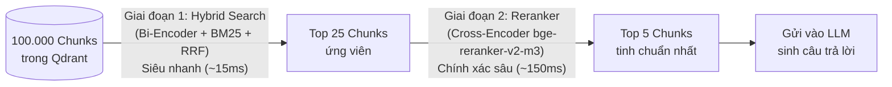

# 02. Giai Đoạn 1: Xử Lý Dữ Liệu Báo Cáo Tài Chính & Advanced Hybrid RAG

> **Mục tiêu tài liệu:** Hiểu từ gốc rễ **RAG (Retrieval-Augmented Generation)** là gì, tại sao cách làm RAG cơ bản trên mạng (Naive RAG) lại thất bại thảm hại khi gặp Báo cáo tài chính PDF, và cách một AI Engineer thực thụ thiết kế hệ thống **Advanced Hybrid RAG + Reranker** đạt độ chính xác cấp doanh nghiệp.

---

## 1. RAG là gì? Tại sao Naive RAG lại thất bại trong Tài chính?

### 1.1. Khái niệm RAG
*   **Vấn đề:** LLM được huấn luyện trên dữ liệu quá khứ và không biết về Báo cáo tài chính Quý 4/2025 hay Quý 1/2026 của công ty FPT vừa công bố.
*   **Giải pháp RAG:** Giống như cho học sinh đi thi được **"mở sách giáo khoa" (Open-book exam)**. Thay vì bắt LLM tự nhớ số liệu:
    1.  **Retrieval (Truy xuất):** Khi người dùng đặt câu hỏi, hệ thống tìm trong kho tài liệu ra đúng 3–5 đoạn văn/bảng biểu có chứa thông tin liên quan.
    2.  **Augmentation (Bổ sung ngữ cảnh):** Nhét câu hỏi của người dùng kèm 3–5 đoạn tài liệu vừa tìm được vào chung một Prompt.
    3.  **Generation (Sinh câu trả lời):** Yêu cầu LLM chỉ được phép dựa vào các đoạn tài liệu trên để tổng hợp câu trả lời và trích dẫn nguồn.

### 1.2. Tại sao "Naive RAG" (RAG ngây thơ) thất bại với Báo cáo tài chính?
Các bài hướng dẫn cơ bản thường dạy bạn: *Đọc chữ từ PDF bằng `PyPDF2` -> Cắt cứ 500 ký tự thành 1 đoạn (chunk) -> Đổi sang Vector -> Tìm kiếm bằng Cosine Similarity.*

Khi áp dụng vào Báo cáo tài chính, cách này **hỏng 100%** vì 3 lý do:
1.  **Vỡ cấu trúc bảng (Broken Tables):** `PyPDF2` đọc văn bản theo dòng từ trái sang phải mà không hiểu bố cục bảng. Các cột *"Năm 2024"*, *"Năm 2025"*, *"Thuyết minh"* và các con số bị trộn lẫn thành một chuỗi chữ vô nghĩa.
2.  **Mất ngữ cảnh khi cắt đoạn (Context Loss):** Giả sử một bảng cân đối kế toán dài 2 trang. Đầu trang ghi *"Đơn vị tính: Triệu VNĐ - Công ty Cổ phần FPT"*. Khi cắt đến dòng thứ 50 ghi *"Lợi nhuận sau thuế: 7.850.000"*, đoạn chunk này hoàn toàn mất thông tin nó thuộc về công ty nào, năm nào, đơn vị là triệu đồng hay tỷ đồng!
3.  **Vector Embedding yếu với từ khóa chính xác (Exact Match Failure):** Vector tìm kiếm ngữ nghĩa rất giỏi hiểu các câu đồng nghĩa, nhưng lại rất kém khi cần tìm chính xác mã chứng khoán (`"FPT"`, `"VCB"`), mã số văn bản (`"Thông tư 200/2014/TT-BTC"`) hoặc con số cụ thể.

---

## 2. Bước 1 của Advanced RAG: Bóc tách PDF & Table-Aware Chunking

Để giải quyết vấn đề vỡ bảng và mất ngữ cảnh, ta thiết kế **Ingestion Pipeline** chuyên biệt:

### 2.1. Layout-Aware Document Parsing (Dùng `Docling`)
Thay vì đọc chữ thô, ta dùng thư viện nhận diện bố cục trang tài liệu (như **Docling** của IBM):
*   Nó dùng mô hình thị giác máy tính (Computer Vision) để phân biệt đâu là **Tiêu đề (Heading)**, đâu là **Đoạn văn (Paragraph)**, đâu là **Bảng biểu (Table)** và đâu là **Chân trang (Footer)**.
*   Toàn bộ các bảng kế toán phức tạp sẽ được chuyển đổi sang định dạng **Markdown Table** hoặc **HTML Table** giữ nguyên hàng và cột:

```markdown
| Chỉ tiêu | Mã số | Năm 2024 (Tỷ VNĐ) | Năm 2025 (Tỷ VNĐ) |
| :--- | :---: | :---: | :---: |
| 1. Doanh thu bán hàng và cung cấp dịch vụ | 01 | 52.618 | 62.849 |
| 2. Giá vốn hàng bán | 11 | 32.105 | 38.012 |
| 3. Lợi nhuận gộp | 20 | 20.513 | 24.837 |
```

### 2.2. Chiến lược Cắt đoạn Giàu Ngữ cảnh (Hierarchical & Context-Enriched Chunking)
1.  **Không bao giờ cắt đôi một bảng nhỏ:** Nếu bảng có kích thước vừa phải (< 800 tokens), giữ nguyên toàn bộ bảng trong 1 chunk. Nếu bảng quá dài, khi tách bảng thành nhiều chunk nhỏ, **bắt buộc phải nhân bản dòng tiêu đề cột (Table Header)** vào đầu mỗi chunk con.
2.  **Đính kèm Metadata & Context Header vào từng Chunk:** Trước khi đưa một đoạn văn đi tạo Vector, ta tự động ghép thêm một dòng tiêu đề ngữ cảnh ở đầu đoạn văn:
    ```text
    [Tài liệu: Báo cáo tài chính Hợp nhất Kiểm toán FPT | Kỳ: Năm 2025 | Mục: Thuyết minh Doanh thu khối Công nghệ | Đơn vị: Tỷ VNĐ]
    Nội dung: Doanh thu chuyển đổi số từ thị trường Nhật Bản đạt 15.200 tỷ đồng, tăng trưởng 32% so với cùng kỳ...
    ```
3.  **Parent-Child Chunking (Cha - Con):**
    *   **Child Chunk (Đoạn con - ~200 tokens):** Ngắn gọn, súc tích để vector biểu diễn đúng 1 ý duy nhất -> Dùng để **Tìm kiếm (Search)**.
    *   **Parent Chunk (Đoạn cha - ~1.000 tokens):** Chứa toàn bộ mục lớn hoặc cả bảng đầy đủ -> Khi tìm trúng Child Chunk, hệ thống sẽ lấy **Parent Chunk** gửi cho LLM để LLM có đầy đủ bức tranh toàn cảnh.

---

## 3. Bước 2: Bản Chất Toán Học Của Vector Embedding & Vector Database (`Qdrant`)

### 3.1. Dense Vector Embedding là gì?
Một mô hình Embedding (ví dụ: **`BAAI/bge-m3`** — mô hình đa ngôn ngữ mạnh nhất hiện nay cho tiếng Việt/Anh) sẽ biến một đoạn văn bản bất kỳ thành một mảng gồm $d$ con số thực (ví dụ $d = 1024$ chiều):

$$\vec{v} = [0.021, -0.045, 0.118, \dots, 0.009] \in \mathbb{R}^{1024}$$

*   **Tính chất kỳ diệu:** Hai câu văn có **ý nghĩa giống nhau** (dù không trùng chữ nào, ví dụ *"Lợi nhuận ròng tăng mạnh"* và *"Lãi sau thuế bứt phá"*) sẽ nằm rất gần nhau trong không gian 1024 chiều này.
*   **Công thức đo độ tương đồng (Cosine Similarity):** Đo góc $\theta$ giữa vector câu hỏi $\vec{q}$ và vector tài liệu $\vec{d}$:

$$\text{CosineSimilarity}(\vec{q}, \vec{d}) = \frac{\vec{q} \cdot \vec{d}}{\|\vec{q}\| \|\vec{d}\|} = \frac{\sum_{i=1}^{1024} q_i d_i}{\sqrt{\sum_{i=1}^{1024} q_i^2} \sqrt{\sum_{i=1}^{1024} d_i^2}}$$

*(Nếu các vector đã được chuẩn hóa độ dài bằng 1 — Normalized Vectors, thì Cosine Similarity chính là phép nhân tích vô hướng **Dot Product** $\vec{q} \cdot \vec{d}$, giúp máy tính tính nhanh hơn rất nhiều).*

### 3.2. Thuật toán HNSW trong Qdrant (Câu hỏi phỏng vấn kinh điển!)
Nếu bạn có 1.000.000 đoạn tài liệu trong Database, mỗi khi người dùng hỏi, nếu lấy vector câu hỏi nhân lần lượt với 1.000.000 vector kia (Exact KNN) thì sẽ mất vài giây — quá chậm!

Các Vector Database như **Qdrant** dùng thuật toán tìm kiếm xấp xỉ **HNSW (Hierarchical Navigable Small World)**:
*   **Nguyên lý:** Giống như hệ thống giao thông nhiều tầng:
    *   **Tầng trên cùng (Layer cao):** Giống như các sân bay quốc tế, chỉ có rất ít điểm nút kết nối xa nhau để nhảy nhanh đến vùng lân cận của câu trả lời.
    *   **Các tầng dưới (Layer thấp dần):** Giống như đường quốc lộ rồi đến đường ngõ hẻm, mật độ điểm dày dần lên để tìm chính xác ngôi nhà cần đến.
*   Nhờ HNSW, độ phức tạp tìm kiếm giảm từ $\mathcal{O}(N)$ xuống chỉ còn $\mathcal{O}(\log N)$, tìm trong hàng triệu tài liệu chỉ mất **3 - 10 mili-giây**!

---

## 4. Bước 3: Hybrid Search (Kết Hợp Ngữ Nghĩa + Từ Khóa) & Thuật Toán RRF

Như đã nói ở mục 1.2, Dense Vector hiểu ngữ nghĩa rất tốt nhưng hay trượt các mã số chính xác (`"FPT"`, `"Q4/2025"`, `"Mã số 20"`). Vì vậy, một hệ thống Advanced RAG luôn chạy **2 luồng tìm kiếm song song**:

1.  **Luồng 1 - Dense Search (Tìm kiếm ngữ nghĩa):** Dùng vector 1024 chiều của `bge-m3`.
2.  **Luồng 2 - Sparse Search / BM25 (Tìm kiếm từ khóa chính xác):**
    *   Thuật toán **BM25 (Best Matching 25)** chấm điểm dựa trên tần suất từ khóa xuất hiện trong đoạn văn (**TF - Term Frequency**) và độ hiếm của từ khóa đó trong toàn bộ kho tài liệu (**IDF - Inverse Document Frequency**).
    *   Những từ hiếm và quan trọng như `"VCB"`, `"EBITDA"`, `"Thuyết minh 24"` sẽ có điểm IDF cực cao.

### Làm sao gộp kết quả của Dense Search và BM25? -> Thuật toán RRF!
Điểm của Cosine Similarity nằm trong khoảng $[-1, 1]$ (ví dụ `0.82`), trong khi điểm của BM25 có thể là một số bất kỳ từ $[0, \infty)$ (ví dụ `14.7`). Bạn không thể lấy hai điểm này cộng trực tiếp với nhau được!

Giải pháp chuẩn công nghiệp là thuật toán **RRF (Reciprocal Rank Fusion)** — gộp dựa trên **thứ hạng (Rank)** thay vì điểm số tuyệt đối:

$$\text{RRF\_Score}(d) = \frac{1}{k + \text{rank}_{\text{dense}}(d)} + \frac{1}{k + \text{rank}_{\text{sparse}}(d)}$$

*(Trong đó $k$ thường là hằng số bằng `60`, $\text{rank}(d)$ là vị trí xếp hạng $1, 2, 3\dots$ của tài liệu $d$ trong từng danh sách).*
*   Nếu một đoạn báo cáo tài chính vừa đứng hạng 2 ở tìm kiếm ngữ nghĩa, vừa đứng hạng 1 ở tìm kiếm từ khóa BM25, nó sẽ có điểm RRF cao nhất và được đẩy lên đầu!

---

## 5. Bước 4: Cross-Encoder Reranker (Bộ Chấm Điểm Tinh Chuẩn Cuối Cùng)

Tại sao đã có Hybrid Search rồi lại vẫn cần thêm **Reranker**? Đây là kiến trúc **Two-Stage Retrieval (Truy xuất 2 giai đoạn)** kinh điển:



*   **Bi-Encoder (Embedding ở Giai đoạn 1):** Tính vector câu hỏi $\vec{q}$ riêng và vector tài liệu $\vec{d}$ riêng, chỉ gặp nhau ở phép nhân tích vô hướng cuối cùng. Nhờ vậy nó cực nhanh (tìm trong 100.000 đoạn mất 15ms), nhưng các từ trong câu hỏi không được tương tác trực tiếp (Self-Attention) với các từ trong tài liệu.
*   **Cross-Encoder (Reranker ở Giai đoạn 2):** Ghép trực tiếp câu hỏi và đoạn tài liệu vào chung một chuỗi `[CLS] Câu hỏi [SEP] Đoạn tài liệu [SEP]` rồi đưa qua toàn bộ các tầng Transformer Self-Attention để chấm một điểm liên quan duy nhất từ `0.0` đến `1.0`.
    *   Nó cực kỳ thông minh và chính xác, nhưng chạy nặng nên không thể chạy trên cả 100.000 đoạn.
    *   Vì vậy, ta dùng Hybrid Search để lọc nhanh từ `100.000` đoạn xuống `Top 25` đoạn, rồi dùng **Cross-Encoder Reranker** (`BAAI/bge-reranker-v2-m3`) chấm điểm kỹ lại 25 đoạn đó để lấy ra **`Top 5` đoạn xuất sắc nhất** đưa vào LLM!

---

## Tóm tắt Checklist Kỹ Thuật Bạn Sẽ Làm Ở Giai Đoạn 1
1.  Thu thập 5–10 Báo cáo tài chính / Báo cáo thường niên PDF thực tế của các mã lớn (FPT, VCB, HPG, VNM).
2.  Viết module bóc tách PDF bằng `Docling`, giữ nguyên bảng biểu dưới dạng Markdown.
3.  Cài đặt bộ cắt đoạn `Table-Aware & Context-Enriched Chunker`.
4.  Khởi chạy `Qdrant` (qua Docker), lưu trữ đồng thời cả **Dense Vector** và **Sparse Vector** kèm **Metadata** (`ticker`, `year`, `quarter`, `doc_type`).
5.  Viết pipeline truy xuất 2 tầng: **Qdrant Hybrid Search (RRF) kèm Metadata Filtering -> Cross-Encoder Reranker -> LLM Generation có trích dẫn nguồn**.
