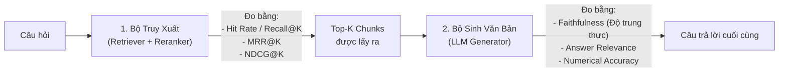

# 03. Giai Đoạn 2: Đo Lường Định Lượng (Evaluation) & Giám Sát Hệ Thống (Observability)

> **Mục tiêu tài liệu:** Trong kỹ thuật AI chuyên nghiệp, có một câu châm ngôn bất hủ: **"If you can't measure it, you can't improve it" (Nếu bạn không đo lường được nó bằng con số, bạn không thể cải tiến nó).** Tài liệu này giúp bạn nắm vững các công thức toán học để chấm điểm hệ thống RAG/Agent tự động và cách theo dõi từng mili-giây hoạt động của hệ thống bằng `Langfuse`.

---

## 1. Tại sao không thể kiểm thử hệ thống AI bằng mắt ("Vibe Check")?

Người mới học thường kiểm tra chatbot bằng cách: gõ thử 3–5 câu hỏi, thấy nó trả lời trôi chảy thì kết luận *"Hệ thống chạy ngon rồi!"*. Cách này gọi là **"Vibe Check"** và cực kỳ nguy hiểm vì:
*   Khi bạn sửa Prompt hoặc đổi kích thước Chunk để sửa lỗi cho câu hỏi số 6, nó có thể âm thầm làm hỏng kết quả của câu hỏi số 1 và số 2 mà bạn không hề biết (**Regression**).
*   Khi phỏng vấn tại **VinAI** hoặc viết CV, câu nói *"Em thêm Reranker thấy chatbot trả lời thông minh hơn"* không có giá trị kỹ thuật. Ngược lại, nếu bạn nói: *"Trên bộ Golden Dataset 150 câu hỏi tài chính, việc kết hợp Hybrid Search (RRF) và Cross-Encoder Reranker giúp tăng chỉ số `Recall@5` từ **68.4%** lên **89.2%** và `MRR@5` từ **0.54** lên **0.78**"*, bạn sẽ lập tức chứng minh được đẳng cấp của một AI Engineer thực thụ.

---

## 2. Cấu trúc của Bộ Dữ Liệu Kiểm Thử Chuẩn (Golden Evaluation Dataset)

Để chấm điểm tự động, ta cần xây dựng một file dữ liệu chuẩn (ví dụ `eval_dataset.json`) gồm khoảng 50–150 mẫu, mỗi mẫu có 4 thành phần:

1.  **`question` (Câu hỏi đầu vào):** *"Doanh thu thuần hợp nhất năm 2025 của FPT đạt bao nhiêu tỷ đồng và tăng trưởng bao nhiêu % so với năm 2024?"*
2.  **`ground_truth_chunk_ids` (ID của các đoạn tài liệu đúng cần tìm ra):** `["fpt_bctc_2025_chunk_14", "fpt_bctc_2025_chunk_15"]`
3.  **`ground_truth_answer` (Câu trả lời đáp án chuẩn):** *"Năm 2025, doanh thu thuần hợp nhất của FPT đạt 62.849 tỷ đồng, tăng trưởng 19,4% so với mức 52.618 tỷ đồng của năm 2024."*
4.  **`difficulty_category` (Phân loại độ khó):** `simple_lookup` (tra cứu 1 số), `table_calculation` (tính toán từ bảng), hoặc `multi_hop_comparison` (so sánh nhiều năm/nhiều công ty).

---

## 3. Hai Nhóm Chỉ Số Đo Lường Cốt Lõi Của Hệ Thống RAG

Một hệ thống RAG có 2 nửa: **Retrieval (Tìm tài liệu)** và **Generation (LLM viết câu trả lời)**. Nếu câu trả lời cuối cùng bị sai, ta phải biết chính xác lỗi nằm ở khâu **Tìm sai tài liệu** hay tìm đúng tài liệu rồi mà **LLM đọc hiểu sai**.

---

### 3.1. Nhóm 1: Các chỉ số đánh giá Tầng Truy Xuất (Retrieval Metrics)

Giả sử với mỗi câu hỏi, hệ thống của bạn lấy ra **Top $K$** đoạn tài liệu (ví dụ $K = 5$).

#### a. Hit Rate@K và Recall@K (Độ phủ)
*   **Hit Rate@K:** Trong 5 đoạn lấy ra, có **ít nhất 1 đoạn đúng** hay không? (Đúng = 1, Sai = 0). Lấy trung bình trên toàn bộ 100 câu hỏi.
*   **Recall@K (Độ thu hồi):** Giả sử để trả lời câu hỏi so sánh năm 2024 và 2025 cần tìm ra **2 đoạn tài liệu chuẩn** trong kho, nhưng Top 5 của bạn chỉ tìm thấy được **1 đoạn**.

$$\text{Recall@K} = \frac{\text{Số đoạn tài liệu chuẩn nằm trong Top } K}{\text{Tổng số đoạn tài liệu chuẩn cần thiết cho câu hỏi đó}}$$

*👉 Ý nghĩa:* Trong RAG, **`Recall@5` là chỉ số quan trọng nhất của tầng Retrieval**. Nếu `Recall@5 = 0` (tức là đoạn văn chứa đáp án không hề lọt vào Top 5 gửi cho LLM), thì LLM có thông minh đến mấy cũng không bao giờ trả lời đúng được ("Rác đầu vào -> Rác đầu ra").

#### b. MRR@K (Mean Reciprocal Rank - Đánh giá chất lượng sắp xếp của Reranker)
`Recall@5` chỉ quan tâm đoạn văn đúng có nằm trong Top 5 hay không, không quan tâm nó đứng ở vị trí số 1 hay vị trí số 5. Nhưng thực tế, đoạn đúng càng đứng lên đầu (hạng 1) thì LLM càng chú ý tốt hơn và ta có thể giảm $K$ từ 5 xuống 3 để tiết kiệm tiền token.

**MRR** tính trung bình nghịch đảo thứ hạng ($\text{rank}_i$) của đoạn tài liệu đúng đầu tiên tìm được trên tập $N$ câu hỏi:

$$\text{MRR} = \frac{1}{N} \sum_{i=1}^{N} \frac{1}{\text{rank}_i}$$

*   Nếu đoạn đúng đứng ở vị trí **#1** -> Điểm = $\frac{1}{1} = 1.0$.
*   Nếu đoạn đúng đứng ở vị trí **#2** -> Điểm = $\frac{1}{2} = 0.5$.
*   Nếu đoạn đúng đứng ở vị trí **#4** -> Điểm = $\frac{1}{4} = 0.25$.
*   Nếu không có trong Top $K$ -> Điểm = $0.0$.

*👉 Ý nghĩa:* Khi bạn thêm **Cross-Encoder Reranker** vào sau Hybrid Search, chỉ số **MRR** sẽ tăng vọt vì Reranker đẩy đoạn văn đúng từ vị trí #4, #5 lên vị trí #1!

---

### 3.2. Nhóm 2: Các chỉ số đánh giá Tầng Sinh Câu Trả Lời (Generation Metrics & RAGAS)

Làm sao chấm điểm một đoạn văn do LLM viết ra? Không thể dùng phép so sánh chuỗi `if answer == ground_truth` vì hai câu văn diễn đạt khác từ ngữ vẫn có thể mang cùng một ý nghĩa đúng.

Hiện nay, chuẩn công nghiệp là kỹ thuật **LLM-as-a-Judge** (dùng một mô hình LLM mạnh cùng bộ khung **RAGAS** hoặc **DeepEval**) để chấm 3 tiêu chí sau:

1.  **Faithfulness (Độ trung thực / Chống ảo giác - Quan trọng số 1 trong Tài chính):**
    *   *Cách RAGAS tính toán:* Nó bóc tách câu trả lời của AI thành từng mệnh đề khẳng định riêng lẻ (Claims). Ví dụ câu trả lời có 4 mệnh đề số liệu. Sau đó nó kiểm tra xem từng mệnh đề có được suy ra trực tiếp từ 5 đoạn tài liệu (Context) đã cung cấp hay không.
    *   Công thức:
        $$\text{Faithfulness} = \frac{\text{Số mệnh đề trong câu trả lời có căn cứ từ Context}}{\text{Tổng số mệnh đề trong câu trả lời}}$$
    *   Nếu `Faithfulness < 1.0`, nghĩa là mô hình đang **bịa đặt (Hallucination)** những thứ không có trong tài liệu!
2.  **Answer Relevance (Độ sát câu hỏi):**
    *   Đánh giá xem câu trả lời có đi thẳng vào trọng tâm câu hỏi của người dùng không, hay trả lời lan man, thiếu ý.
3.  **Answer Correctness / Numerical Accuracy (Độ chính xác so với Đáp án chuẩn):**
    *   So sánh câu trả lời của hệ thống với `ground_truth_answer`. Đặc biệt trong dự án **VnFinCopilot**, chúng ta sẽ viết thêm một hàm kiểm tra **Exact Number Match** (trích xuất các con số trong câu trả lời và so khớp sai số $< 0.01$ với đáp án chuẩn).

---

## 4. Hệ Thống Giám Sát & Theo Dõi Vết (Observability với `Langfuse`)

Khi hệ thống chạy phức tạp (qua nhiều bước: Rewrite câu hỏi -> Tìm Qdrant -> Rerank -> Gọi LLM), nếu một câu hỏi mất tới **8 giây** mới trả lời xong hoặc trả lời sai, làm sao bạn biết nó bị nghẽn ở bước nào?

Chúng ta sử dụng **Langfuse** (một nền tảng LLMOps mã nguồn mở chạy trực tiếp trên máy bạn qua Docker):

*   **Tracing & Spans (Theo dõi vết từng bước):** Mỗi câu hỏi của người dùng tạo ra 1 **Trace**. Bên trong Trace đó hiển thị biểu đồ thời gian (Waterfall) của từng bước con (**Span**):
    *   `Embedding Query`: `45ms`
    *   `Qdrant Hybrid Search`: `12ms`
    *   `Cross-Encoder Rerank`: `180ms`
    *   `LLM Generation`: `1.250ms` (Input: `1.420 tokens`, Output: `185 tokens`, Chi phí: `$0.0004`)
*   **Prompt Management (Quản lý phiên bản Prompt):** Lưu trữ lịch sử chỉnh sửa Prompt (`v1`, `v2`, `v3`) để biết phiên bản Prompt nào cho điểm Evaluation cao nhất.

---

## Tóm tắt Checklist Kỹ Thuật Bạn Sẽ Làm Ở Giai Đoạn 2
1.  Xây dựng bộ **Golden Dataset** gồm 50–100 câu hỏi tài chính Việt Nam kèm đáp án và ID đoạn văn chuẩn.
2.  Tự cài đặt các hàm tính toán toán học cho **`Hit Rate@K`**, **`Recall@K`**, **`MRR@K`** bằng Python thuần (để hiểu sâu bản chất thuật toán).
3.  Tích hợp bộ chấm điểm **LLM-as-a-Judge / RAGAS** để đo `Faithfulness` và `Answer Correctness`.
4.  Chạy một bài **Ablation Study (Thực nghiệm đối chứng)** lưu thành bảng báo cáo Markdown:
    *   *Cấu hình 1:* Chỉ dùng Dense Search.
    *   *Cấu hình 2:* Dùng Hybrid Search (Dense + BM25 + RRF).
    *   *Cấu hình 3:* Dùng Hybrid Search + Cross-Encoder Reranker.
    *(Bảng số liệu này chính là "vũ khí hạng nặng" trong hồ sơ của bạn khi ứng tuyển VinAI!).*
5.  Khởi chạy **Langfuse** và gắn decorator `@observe()` vào pipeline để theo dõi độ trễ và lượng token tiêu thụ.
