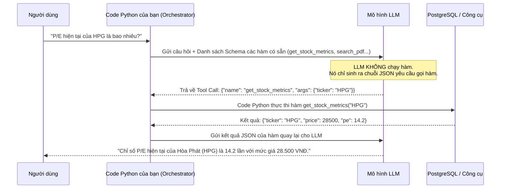
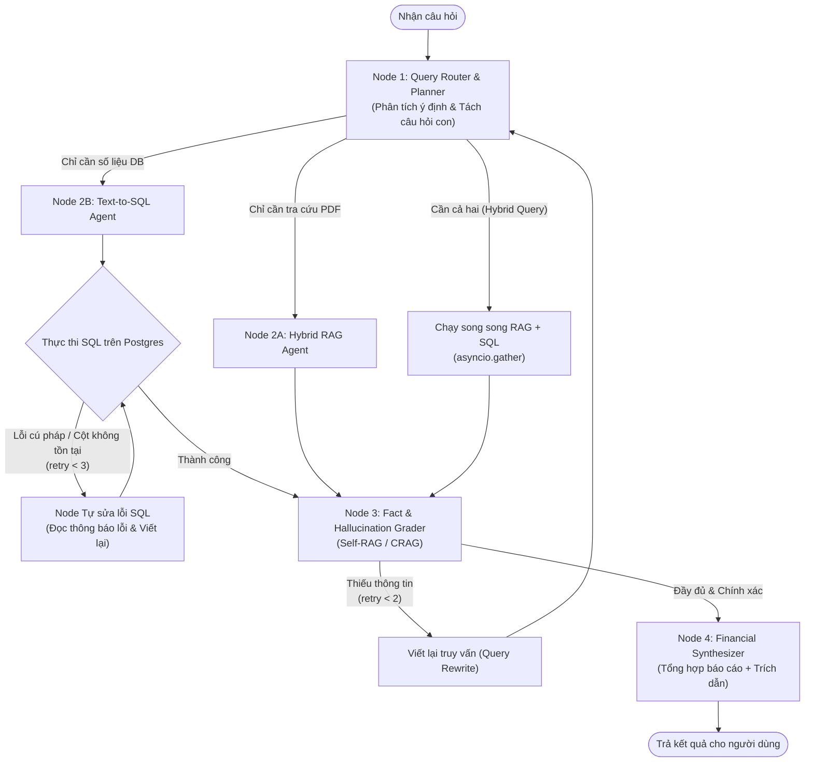

# 04. Giai Đoạn 3: Hệ Thống Multi-Agent, Tool Calling & Text-to-SQL

> **Mục tiêu tài liệu:** Đưa hệ thống của bạn vượt qua giới hạn của một hệ thống RAG tĩnh để trở thành một **Hệ thống Tự chủ (Agentic AI)** có khả năng: tự lập kế hoạch, biết sử dụng công cụ bên ngoài (chạy câu lệnh SQL trên PostgreSQL, gọi máy tính Python để tính toán chỉ số tài chính), tự phát hiện lỗi để sửa lại, và tổng hợp báo cáo từ nhiều nguồn dữ liệu khác nhau.

---

## 1. RAG thông thường vs AI Agent: Sự khác biệt nằm ở đâu?

*   **RAG thông thường (Pipeline tuyến tính cố định):**
    Luồng chạy bị khóa cứng theo một đường thẳng: `Nhận câu hỏi -> Tìm Qdrant -> Rerank -> Trả lời`.
    *   *Điểm yếu:* Nếu người dùng hỏi: *"So sánh tốc độ tăng trưởng doanh thu 4 quý gần nhất của FPT và VCB từ cơ sở dữ liệu, sau đó giải thích động lực tăng trưởng của công ty có tốc độ cao hơn dựa theo Báo cáo thường niên"*, RAG thông thường sẽ bó tay vì nó không biết truy vấn bảng SQL, không biết so sánh xem công ty nào cao hơn trước rồi mới đi tìm PDF của công ty đó!
*   **AI Agent (Luồng điều khiển động - Dynamic Control Flow):**
    Bạn dùng LLM làm **"Bộ não điều phối" (Reasoning Engine)**. Nó tự quyết định:
    1.  Cần gọi công cụ nào trước? (`SQL Tool` hay `RAG Tool` hay `Python Calculator`?)
    2.  Quan sát kết quả trả về từ công cụ đó, nếu bị lỗi hoặc chưa đủ thông tin thì tự gọi tiếp bước thứ 2, thứ 3.
    3.  Khi nào đủ dữ liệu đã được kiểm chứng thì mới kết thúc và trả lời người dùng.

---

## 2. Hai Cơ Chế Nền Tảng Của Agent: Function Calling & Structured Outputs

Làm sao một mô hình ngôn ngữ (vốn chỉ sinh ra chữ) lại có thể "bấm nút" chạy một hàm Python hoặc truy vấn Database?

### 2.1. Function Calling (Tool Use) hoạt động thế nào?
Một hiểu lầm phổ biến của người mới là: *"LLM tự kết nối vào Database để chạy lệnh SQL"*. **Hoàn toàn sai!** LLM không bao giờ tự chạy code của bạn. Quá trình thực sự diễn ra qua 4 bước:

### 2.2. Structured Outputs & Constrained Decoding (Kiến thức sâu cho VinAI)
Khi LLM sinh ra chuỗi JSON để gọi hàm hoặc phân loại ý định (Router), làm sao đảm bảo 100% nó không bao giờ sinh thiếu dấu ngoặc nhọn `}` hoặc viết sai tên trường dữ liệu?

Các engine hiện đại (như `vLLM`, `Outlines`, hay OpenAI Structured Outputs) sử dụng kỹ thuật **Constrained Decoding (Giải mã có ràng buộc bằng Máy trạng thái hữu hạn - FSM / Context-Free Grammar)**:
*   Ở mỗi bước dự đoán token tiếp theo (xem lại Bài 01), nếu theo quy tắc cú pháp JSON Schema (định nghĩa bởi `Pydantic`), vị trí hiện tại **bắt buộc phải là một dấu ngoặc kép `"` hoặc một chữ số**, hệ thống sẽ can thiệp trực tiếp vào mảng xác suất **Logits**: gán xác suất của tất cả các token không hợp lệ về $-\infty$ (`0%`).
*   Nhờ vậy, mô hình **bắt buộc về mặt toán học** phải sinh ra đúng cấu trúc Pydantic Schema 100% mà không bao giờ bị lỗi cú pháp JSON!

---

## 3. Thiết Kế Đồ Thị Trạng Thái Với `LangGraph` (State Machine Architecture)

Trong môi trường Production, người ta **không để một Agent tự do chạy vòng lặp vô tận (Autonomous Loop không kiểm soát)** vì nó rất dễ đi lạc đề, tốn hàng chục giây và đốt tiền API.

Thay vào đó, các kỹ sư AI dùng **Đồ thị Trạng thái (State Graph / `LangGraph`)** để kiểm soát chặt chẽ các bước chuyển trạng thái:

*   **State (Trạng thái dùng chung):** Một đối tượng `TypedDict` hoặc `Pydantic` lưu trữ toàn bộ thông tin xuyên suốt phiên xử lý: câu hỏi gốc, danh sách câu hỏi con, kết quả SQL đã lấy, các đoạn PDF đã tìm, số lần thử lại (`retry_count`), và kết quả kiểm tra ảo giác.
*   **Nodes (Các nút xử lý):** Mỗi Node là một hàm Python bất đồng bộ nhận vào `State` hiện tại, thực hiện một nhiệm vụ chuyên biệt và cập nhật lại `State`.
*   **Edges & Conditional Edges (Các cạnh rẽ nhánh có điều kiện):** Quy định rõ sau khi chạy xong Node A thì đi tới Node B hay quay lại sửa lỗi dựa trên giá trị trong `State`.

### Sơ đồ Luồng Đồ Thị Agent của VnFinCopilot:

---

## 4. Giải Phẫu Chuyên Sâu: Text-to-SQL Agent Cho Dữ Liệu Chứng Khoán

Trong tài chính, các câu hỏi như:
*   *"Liệt kê Top 5 ngân hàng có ROE cao nhất quý 4/2025"*
*   *"Tính tỷ lệ tăng trưởng doanh thu trung bình của FPT trong 3 năm gần nhất"*
đều phải được giải quyết bằng cách truy vấn cơ sở dữ liệu **PostgreSQL**.

Để xây dựng một **Text-to-SQL Agent** an toàn và chính xác, bạn sẽ học và áp dụng 4 kỹ thuật cốt lõi sau:

### 4.1. Schema Pruning & Few-Shot Prompting
*   Database thực tế có thể có hàng chục bảng. Không bao giờ nhét toàn bộ cấu trúc của 50 bảng vào Prompt. Chỉ cung cấp định nghĩa (`CREATE TABLE` + mô tả ý nghĩa từng cột + 3 dòng dữ liệu mẫu) của các bảng liên quan:
    *   Bảng `companies` (Mã CK, Tên công ty, Sàn giao dịch HOSE/HNX, Ngành nghề).
    *   Bảng `quarterly_financials` (Mã CK, Năm, Quý, Doanh thu, Lợi nhuận gộp, Lợi nhuận sau thuế, Tổng tài sản, Vốn chủ sở hữu, ROE, ROA, EPS).
    *   Bảng `daily_stock_prices` (Mã CK, Ngày giao dịch, Giá đóng cửa, Khối lượng, P/E, P/B).
*   Cung cấp 3–5 ví dụ mẫu (**Few-shot examples**) về cách chuyển câu hỏi tài chính tiếng Việt sang câu lệnh PostgreSQL chuẩn.

### 4.2. Bảo mật Tuyệt đối (Read-Only Execution)
*   Tác nhân AI sinh câu lệnh SQL chỉ được phép kết nối vào PostgreSQL bằng một tài khoản **Read-Only (`SELECT` only)**, có thiết lập `statement_timeout = 3000ms` (3 giây).
*   Trước khi thực thi, có bộ lọc từ khóa và phân tích cú pháp SQL để chặn tuyệt đối các lệnh phá hoại như `DROP`, `DELETE`, `UPDATE`, `INSERT`, `ALTER`.

### 4.3. Vòng lặp Tự sửa lỗi (Self-Correction Loop)
LLM đôi khi có thể viết sai tên cột hoặc dùng sai hàm ngày tháng của PostgreSQL. Thay vì để hệ thống văng lỗi 500 ra màn hình người dùng:
1.  Hệ thống bắt lỗi `PostgresError` (ví dụ: `column "net_income" does not exist. Did you mean "net_profit"?`).
2.  Đưa câu lệnh SQL bị lỗi kèm nguyên văn thông báo lỗi của PostgreSQL quay trở lại cho Agent.
3.  Agent đọc thông báo lỗi, tự sửa `"net_income"` thành `"net_profit"` và chạy lại thành công ngay ở lần thử thứ 2!

### 4.4. Không bao giờ để LLM tự tính nhẩm!
Nếu người dùng hỏi phép tính phức tạp (như tính tốc độ tăng trưởng kép hàng năm **CAGR** hoặc độ lệch chuẩn giá cổ phiếu), LLM tự nhẩm sẽ sai số. Ta ép Agent phải thực hiện phép tính ngay bên trong câu lệnh SQL (`AVG`, `SUM`, `STDDEV`, biểu thức toán học) hoặc gọi công cụ **Python Calculator Tool** để trả về con số chính xác tuyệt đối đến từng chữ số thập phân.

---

## Tóm tắt Checklist Kỹ Thuật Bạn Sẽ Làm Ở Giai Đoạn 3
1.  Thiết kế cơ sở dữ liệu **PostgreSQL** lưu trữ dữ liệu tài chính theo quý và lịch sử giá của các mã chứng khoán tiêu biểu tại Việt Nam (FPT, VCB, HPG, VNM, VIC, TCB, MBB...).
2.  Xây dựng **Text-to-SQL Tool** có cơ chế Read-only Guardrail và vòng lặp tự sửa lỗi (Self-Correction).
3.  Xây dựng **Multi-Agent State Graph** bằng `LangGraph` kết hợp cả **Hybrid RAG (Giai đoạn 1)** và **Text-to-SQL**.
4.  Cài đặt **Node Kiểm chứng Số liệu (Fact & Hallucination Grader - Self-RAG)**: đối chiếu mọi con số trong bản nháp câu trả lời với kết quả trả về từ SQL và PDF trước khi xuất ra cho người dùng.
